  

  

  
  
  

 

## 👋 关于我

> 用数据讲故事，用代码把想法跑起来。

- 🔭 目前在做：**中国第七次人口普查 · 数据分析与可视化**
- 🌱 正在学习：**前端工程化 · Java 后端 · 数据可视化**
- 💬 可以聊：**数据分析、网页开发、把想法做成能跑的东西**
- ⚡ 小习惯：先跑通，再优雅

 

## 🧰 技术栈

  
  
  
  
  
  
  
  

 

## 📊 GitHub 数据

  

  

 

## 🚀 精选项目

| 项目 | 简介 | 技术 |
| :-- | :-- | :-- |
| **[Data-Analysis-Census](https://github.com/kaike-w/Data-Analysis-Census)** | 中国第七次人口普查数据分析与可视化 | `HTML` `Data` |
| **[nowbule.github.io](https://github.com/kaike-w/nowbule.github.io)** | 个人 Web 页面 | `HTML` `CSS` |
| **[hs_education](https://github.com/kaike-w/hs_education)** | 教育相关 Java 项目 | `Java` |

 

  
   
  ⭐️ 如果我的项目对你有帮助，欢迎点个 Star · Thanks for stopping by!

