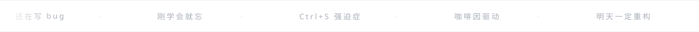
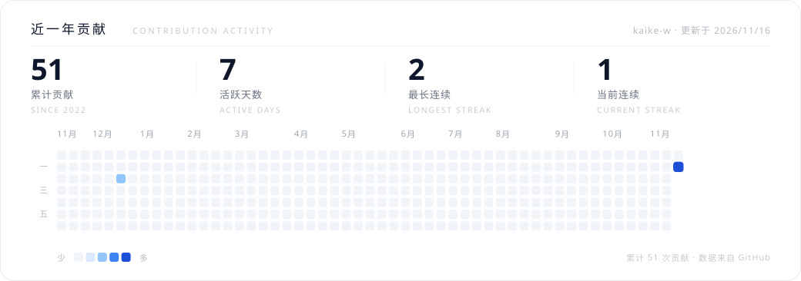
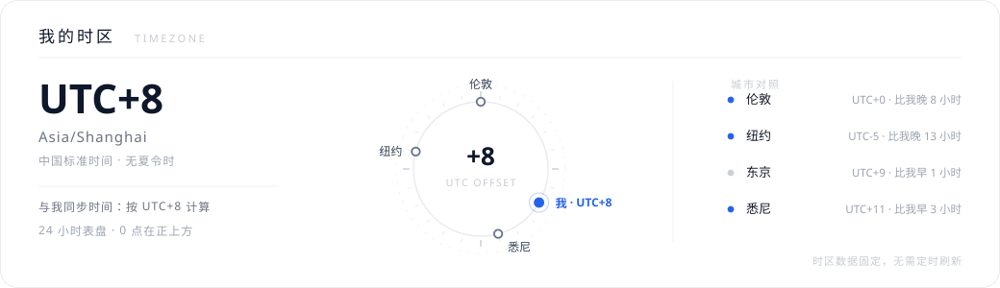

  

  

  
  
  

  

 

  

 

  

 

## 📈 最近一年

  

## 🌍 我的时区

  

## 🚧 折腾现场

| 项目 | 一句话 |
| :-- | :-- |
| **[Data-Analysis-Census](https://github.com/kaike-w/Data-Analysis-Census)** | 把一份普查数据变成会说话的图表 |
| **[nowbule.github.io](https://github.com/kaike-w/nowbule.github.io)** | 自己搭的小站，偶尔去打扫 |
| **[hs_education](https://github.com/kaike-w/hs_education)** | 写着写着就开始面向对象 |

  
   
  
   
  今天也要早点睡 · 欢迎点个 Star ⭐️
   
  

